# Anchoring architecture

How a ZCG grant application becomes a preserved archive with a Zcash mainnet anchor, and how anyone can check it. This is the conceptual view: it names the parts and the rules, not servers, hostnames, ports or key locations.

## What the anchor is for

Participate keeps a copy of every eligible application as a file package: the Markdown of the proposal, its source metadata and a manifest that lists every file with its SHA-256 digest. The manifest itself has a digest, the manifest hash. Anchoring publishes a commitment to those digests on the Zcash blockchain, so the bytes can later be checked against a timestamp that no single operator controls.

The anchor proves that a given set of file digests existed at or before the block time. It does not prove who wrote the proposal, whether the committee endorsed it, or whether anything was paid. The block time is separate from the application date and from any decision date.

## The parts

| Part                  | Role                                                                                                                                                                                                                                                               |
| --------------------- | ------------------------------------------------------------------------------------------------------------------------------------------------------------------------------------------------------------------------------------------------------------------ |
| OpenZcash portal      | Renders the Participate workspace and the public Read & verify panel. Reads the service server-to-server. Never holds wallet keys.                                                                                                                                 |
| Participation service | Stores archives, revisions, discussions, committee data and chain evidence in PostgreSQL. Exposes the public archive API that the portal forwards.                                                                                                                 |
| Archive worker        | A process on a virtual private server, run by system timers. Discovers applications, builds packages, batches them, requests anchors, verifies inclusion and alerts by email. Holds no spending key.                                                               |
| Signing host          | A separate machine with a Zallet wallet beside a Zebra full node. Builds and signs the anchoring transaction. The worker reaches it only through an SSH tunnel with a restricted command channel: a closed list of read and anchor actions, with no balance reads. |
| Zcash mainnet         | Carries the shielded Sapling transaction whose memo holds the commitment.                                                                                                                                                                                          |
| Public verification   | A dedicated public viewing key for the archive receiver, a chain receipt per record, and a verifier script that runs offline on the downloaded package.                                                                                                            |

## The flow

1. **Discovery.** Every five minutes the worker queries GitHub for open issues in the ZcashCommunityGrants application repository that carry both labels "Grant Application" and "Ready For ZCG Review" and no decision label. Applications that gain a decision label leave the eligible set; an application withdrawn on GitHub keeps its preserved files but closes further review.
2. **Capture.** Each eligible application becomes a record with a revision: proposal Markdown, source metadata and a manifest (schema ZVOICE_ARCHIVE_V1) with one SHA-256 per file. The manifest is canonical JSON, so its hash is reproducible. The package is downloadable as one .zvoice.json file.
3. **Batching.** The worker sorts the manifest hashes of the pending revisions and builds a Merkle tree over them (schema PARTICIPATE_MERKLE_V1, domain-separated SHA-256 leaves and branches). The root commits to every record in the batch, and each record keeps its inclusion path.
4. **Anchor request.** The worker asks the signing host, through the restricted channel, to anchor the root. The memo is fixed: `PARTICIPATE|ARCHIVE|v1|mainnet|count:N|sha256:<root>`. A single-record anchor uses the form `ZVOICE|ARCHIVE|v1|<network>|<recordId>|r<revision>|sha256:<manifestHash>`.
5. **Signing and broadcast.** On the signing host, Zallet assembles the transaction as a PCZT (partially created Zcash transaction), signs it and broadcasts it through the Zebra node. The output is a shielded Sapling note to the archive receiver, with the memo above. The worker receives the transaction id, never a key.
6. **Verification.** The worker's cycle runs every minute. It waits for 10 confirmations on mainnet, then reads the transaction with a view-only reader (Zallet with the public viewing key) and records the evidence: transaction id, Sapling output index, receiver, memo, block hash, height and time, confirmations against the required depth, the chain tip at check time, the reader version and the public viewing key. Evidence is validated against a strict schema that excludes any RPC configuration or operator credential.
7. **Monitoring and backups.** A monitor runs every two minutes and sends email alerts when a cycle fails or a submission needs an operator. Encrypted backups run daily.
8. **Publication.** The portal's Read & verify panel shows the preserved record, the file inventory, the manifest hash, the transaction, the block and the memo, with downloads for the revision, the Markdown, the chain receipt and the verifier.

## Verification policy

- Mainnet anchors require at least 10 confirmations before they count as verified.
- A saved check is trusted for 15 minutes. After that the panel shows "Check required" with the stored evidence still visible, until the worker records a fresh check. Confirmed inclusion never becomes "unverified"; only the label asks for a fresh observation.
- Evidence must match the record: same network, same receiver, the exact expected memo, a transaction id known to the anchor, a block at or after the viewing key's birthday height, and a confirmation count consistent with the chain tip.
- A failed check never establishes inclusion. A positive memo proof does not certify any wallet balance.

## What a reader can do without trusting the portal

1. Download the .zvoice.json package and the verifier script from Read & verify.
2. Run the verifier on the package with the published manifest hash. It recomputes every file digest and the manifest hash, and can extract the files into a new folder. This step works offline.
3. With a synchronized Zebra node and a view-only Zallet reader that imports only the published viewing key, run the verifier with the transaction id and the chain receipt. It recomputes the Merkle path, rebuilds the expected memo and checks that the transaction carries it in a canonical block at the required depth.

The verifier never signs or sends transactions.

## Current state

- 25 proposals are anchored in one transaction, `1bb7383043cab4d72b7129b5e5bdc7441ac7c073af59679bb91403216b795bf1`, included at block 3,512,569 of Zcash mainnet with the memo `PARTICIPATE|ARCHIVE|v1|mainnet|count:25|sha256:563d2af21845dfc7680ce1d58313c91588cf8b500837f396151104c6c0035bce`.
- No application is pending an anchor.
- Signed committee receipts carry their own cryptographic verification (round fingerprint and WebAuthn signatures) and do not yet have a Zcash anchor.

## Diagram

```mermaid
flowchart LR
  subgraph Sources["Public sources"]
    GH["GitHub issues\nGrant Application + Ready For ZCG Review"]
  end

  subgraph Worker["Archive worker (timers)"]
    D["Discovery\nevery 5 min"]
    C["Capture\npackage + manifest SHA-256"]
    B["Batch\nMerkle root over manifest hashes"]
    V["Verify\nafter 10 confirmations, every 1 min cycle"]
    M["Monitor\nevery 2 min, email alerts\ndaily encrypted backups"]
  end

  subgraph Signer["Signing host (separate machine)"]
    Z["Zallet wallet\nPCZT build + sign"]
    N["Zebra full node\nbroadcast + chain reads"]
  end

  subgraph Chain["Zcash mainnet"]
    T["Shielded Sapling transaction\nmemo PARTICIPATE|ARCHIVE|v1|mainnet|count:N|sha256:root"]
  end

  subgraph Service["Participation service"]
    DB["PostgreSQL\narchives, revisions, evidence"]
    API["Archive API\nrecord, proof, downloads"]
  end

  subgraph Portal["OpenZcash"]
    RV["Read & verify panel\ntxid, block, memo, receipts"]
  end

  subgraph Reader["Independent reader"]
    VK["Public viewing key\n+ verifier script"]
  end

  GH --> D --> C --> B
  B -- "restricted SSH channel\n(anchor and read actions only)" --> Z
  Z --> N --> T
  T -- "view-only read" --> V
  V --> DB
  C --> DB
  DB --> API --> RV
  M -.-> D
  M -.-> V
  T -. "decode memo with the viewing key" .-> VK
  RV -- "package + chain receipt" --> VK
```

